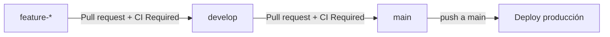

# CI/CD con GitHub Actions, Cloud Build y Cloud Run

Este documento define el flujo operativo de Bukky para trabajo colaborativo y despliegue a producción.

## Arquitectura de ramas



- Los PR hacia `develop` solo pueden venir de ramas `feature-*`.
- Los PR hacia `main` solo pueden venir de `develop`.
- Un push a `develop` no despliega.
- Un pull request hacia `main` no despliega.
- Un push a `main` inicia el despliegue de producción.
- `workflow_dispatch` solo debe ejecutarse desde `main` y despliega el HEAD de `main`.

## Workflows

### Pull Request Validation

Archivo: `.github/workflows/pull-request-validation.yml`.

Se ejecuta en PR hacia `develop` y `main`.

Jobs principales:

- `Branch policy`: valida origen y destino del PR.
- `Format check`: ejecuta `pnpm ci:format`.
- `Lint`: ejecuta lint backend y frontend.
- `Typecheck`: ejecuta typecheck backend y frontend.
- `Unit tests`: ejecuta pruebas unitarias backend y frontend.
- `Backend integration tests`: levanta PostgreSQL, ejecuta migraciones y corre integración real.
- `Backend e2e tests`: levanta PostgreSQL y prueba el endpoint real `/api/health`.
- `Builds`: compila backend y frontend.
- `CI Required`: único check que debe configurarse como obligatorio en GitHub.

Los PR en draft solo ejecutan política de ramas. Al marcar el PR como listo, corren los checks pesados.

### Deploy Production

Archivo: `.github/workflows/deploy-production.yml`.

Se ejecuta en:

- `push` a `main`;
- `workflow_dispatch` desde `main`.

El workflow:

1. Revalida el commit de `main`.
2. Autentica contra Google Cloud mediante Workload Identity Federation.
3. Ejecuta `gcloud builds submit` con `cloudbuild.production.yaml`.

No usa claves JSON.

## Cloud Build de producción

Archivo: `cloudbuild.production.yaml`.

Orden de ejecución:

1. Validar substitutions.
2. Construir imagen backend.
3. Construir imagen frontend.
4. Construir imagen de operaciones/migración.
5. Publicar imagen backend.
6. Publicar imagen frontend.
7. Publicar imagen de operaciones.
8. Actualizar la imagen del Cloud Run Job de migraciones.
9. Ejecutar migraciones y esperar resultado.
10. Desplegar backend.
11. Verificar que la revisión backend usa la imagen del commit.
12. Smoke test backend sobre `/api/health`.
13. Desplegar frontend.
14. Verificar que la revisión frontend usa la imagen del commit.
15. Smoke test frontend.

Las imágenes se etiquetan con el SHA del commit. No se despliega usando únicamente `latest`.

## Migraciones

La pipeline usa el Cloud Run Job existente:

- Job por defecto: `bukky-db-migrate`.
- Imagen: target `operations` de `booking-system-backend/Dockerfile`.
- Comando del contenedor: `pnpm run migration:run`.

La pipeline solo actualiza la imagen del Job y conserva su configuración existente:

- service account;
- VPC;
- secrets;
- variables;
- Cloud SQL attachment, si existe;
- timeout;
- retries;
- memoria y CPU.

No ejecuta seeds. No ejecuta `migration:revert`. Si `migration:run` falla, Cloud Build se detiene.

## Variables requeridas en GitHub Environment `production`

Repository/Environment variables:

```text
GCP_PROJECT_ID=bukky-production
GCP_REGION=us-central1
GCP_WORKLOAD_IDENTITY_PROVIDER=projects/PROJECT_NUMBER/locations/global/workloadIdentityPools/github-actions/providers/github
GCP_DEPLOY_SERVICE_ACCOUNT=github-production-deployer@bukky-production.iam.gserviceaccount.com
GCP_CLOUD_BUILD_SERVICE_ACCOUNT=bukky-cloud-build@bukky-production.iam.gserviceaccount.com
GCP_ARTIFACT_REPOSITORY=bukky
GCP_BACKEND_SERVICE=bukky-backend
GCP_FRONTEND_SERVICE=bukky-frontend
GCP_MIGRATION_JOB=bukky-db-migrate
PRODUCTION_BACKEND_SMOKE_URL=https://api.bukky.wegox.io/api/health
PRODUCTION_FRONTEND_SMOKE_URL=https://bukky.wegox.io
NEXT_PUBLIC_API_URL=https://api.bukky.wegox.io/api
NEXT_PUBLIC_APP_DOMAIN=https://bukky.wegox.io
NEXT_PUBLIC_AUTH_CSRF_COOKIE_NAME=bukky_csrf
NEXT_PUBLIC_AUTH_CSRF_HEADER_NAME=x-csrf-token
NEXT_PUBLIC_TURNSTILE_SITE_KEY=site-key-publica-real
NEXT_PUBLIC_TURNSTILE_LOGIN_ACTION=login
NEXT_PUBLIC_TURNSTILE_BOOKING_ACTION=booking_create
NEXT_PUBLIC_TURNSTILE_RESCHEDULE_ACTION=booking_reschedule
NEXT_PUBLIC_SENTRY_ENABLED=true
NEXT_PUBLIC_SENTRY_DSN=https://public-key@oXXXX.ingest.sentry.io/project
NEXT_PUBLIC_SENTRY_ENVIRONMENT=production
NEXT_PUBLIC_SENTRY_TRACES_SAMPLE_RATE=0.02
NEXT_PUBLIC_SENTRY_REPLAYS_SESSION_SAMPLE_RATE=0
NEXT_PUBLIC_SENTRY_REPLAYS_ON_ERROR_SAMPLE_RATE=0.1
```

No uses placeholders para `NEXT_PUBLIC_TURNSTILE_SITE_KEY`. La pipeline rechaza valores vacíos y placeholders conocidos.

## Secrets requeridos en GitHub

Para este diseño no se requieren secretos runtime del backend en GitHub.

El backend y el Job de migraciones deben seguir obteniendo desde Secret Manager/Cloud Run:

- base de datos;
- JWT;
- AWS/S3;
- Resend;
- Turnstile Secret Key;
- Sentry DSN backend, si se decide mantenerlo como secreto runtime;
- cualquier secreto adicional de backend.

Si prefieres tratar `NEXT_PUBLIC_SENTRY_DSN` como secret aunque sea público por diseño, puedes moverlo a GitHub Environment Secret y ajustar el workflow.

## Recursos Google Cloud que debe configurar el operador

- Artifact Registry repository: `bukky`.
- Cloud Run service backend: `bukky-backend`.
- Cloud Run service frontend: `bukky-frontend`.
- Cloud Run Job migraciones: `bukky-db-migrate`.
- Service account para GitHub WIF.
- Service account de ejecución para Cloud Build.
- Runtime service accounts existentes para backend, frontend y Job.
- Secret Manager para secretos runtime.

## IAM y Workload Identity Federation

Script guía no ejecutado automáticamente:

```powershell
.\scripts\gcp\setup-github-workload-identity.ps1 `
  -ProjectId bukky-production `
  -ProjectNumber PROJECT_NUMBER `
  -GitHubOwner OWNER `
  -GitHubRepository REPOSITORY `
  -RuntimeServiceAccounts @(
    'bukky-backend-runtime@bukky-production.iam.gserviceaccount.com',
    'bukky-frontend-runtime@bukky-production.iam.gserviceaccount.com',
    'bukky-jobs-runtime@bukky-production.iam.gserviceaccount.com'
  )
```

Roles mínimos aproximados:

GitHub deploy service account:

- `roles/cloudbuild.builds.editor` sobre el proyecto.
- `roles/iam.workloadIdentityUser` concedido al principal federado del repo exacto.

Cloud Build execution service account:

- `roles/artifactregistry.writer`.
- `roles/run.admin`.
- `roles/logging.logWriter`.
- `roles/iam.serviceAccountUser` sobre las runtime service accounts necesarias.

No conceder `Owner` ni `Editor`. No crear claves JSON.

## Branch protection / Rulesets

Configurar en GitHub. Los workflows no bloquean merges por sí solos.

Para `develop`:

- Require a pull request before merging.
- Require at least 1 approving review.
- Dismiss stale approvals when new commits are pushed.
- Require approval of the most recent reviewable push si el plan lo permite.
- Require status checks to pass.
- Required check: `CI Required`.
- Require branches to be up to date before merging.
- Require conversation resolution.
- Block force pushes.
- Block deletions.
- Do not allow bypassing, si la organización lo permite.

Para `main`:

- Require a pull request before merging.
- Require at least 1 approving review.
- Required check: `CI Required`.
- Require conversation resolution.
- Block direct pushes.
- Block force pushes.
- Block deletions.

No marques como required checks internos como `Backend Tests`, `Lint` o `Builds`. El único check obligatorio debe ser `CI Required`.

Script opcional no ejecutado automáticamente:

```powershell
.\scripts\github\configure-branch-protection.ps1 -Owner OWNER -Repository REPOSITORY
```

## Primera activación segura

Fase 1:

1. Abrir PR de prueba `feature-ci-test` hacia `develop`.
2. Confirmar que `Branch policy` pasa.
3. Confirmar que `CI Required` refleja correctamente los checks.
4. Activar ruleset de `develop`.

Fase 2:

1. Abrir PR `develop` hacia `main`.
2. Confirmar validaciones.
3. Ejecutar `Deploy Production` manualmente desde `main` cuando WIF y Cloud Build estén listos.
4. Confirmar migraciones, backend, frontend y dominios.

Fase 3:

1. Activar ruleset de `main`.
2. Confirmar despliegue automático por merge a `main`.

No pruebes por primera vez con push directo a `main`.

## Rollback

Identificar despliegue actual:

```powershell
.\scripts\gcp\inspect-production-deployment.ps1 -ProjectId bukky-production
```

Rollback de backend:

```powershell
.\scripts\gcp\rollback-production.ps1 `
  -ProjectId bukky-production `
  -Service backend `
  -Image us-central1-docker.pkg.dev/bukky-production/bukky/bukky-backend:SHA_ANTERIOR
```

Rollback de frontend:

```powershell
.\scripts\gcp\rollback-production.ps1 `
  -ProjectId bukky-production `
  -Service frontend `
  -Image us-central1-docker.pkg.dev/bukky-production/bukky/bukky-frontend:SHA_ANTERIOR
```

Restaurar imagen no revierte base de datos. Si una migración cambió estructura o datos, el rollback de app puede requerir una decisión manual de base de datos.

Si backend despliega y frontend falla, producción queda con backend nuevo y frontend anterior. Revisa Cloud Build, decide si repetir el workflow o restaurar backend.

## Diagnóstico

Cloud Build:

```powershell
gcloud builds list --project bukky-production --region us-central1 --limit 10
gcloud builds log BUILD_ID --project bukky-production --region us-central1
```

Migraciones:

```powershell
gcloud run jobs executions list --job bukky-db-migrate --project bukky-production --region us-central1
gcloud run jobs executions describe EXECUTION_NAME --project bukky-production --region us-central1
```

Cloud Run:

```powershell
gcloud run services describe bukky-backend --project bukky-production --region us-central1
gcloud run services describe bukky-frontend --project bukky-production --region us-central1
```

Commit desplegado:

- Revisa la imagen activa de la revisión Ready.
- El tag debe ser el SHA del commit.
